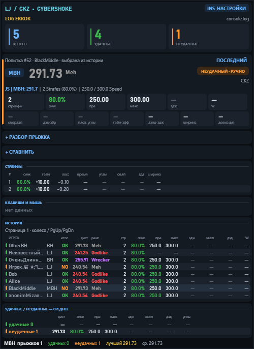

# CS2 LJ Overlay

## DOWNLOAD FOR WINDOWS

1. Download [LJOverlay_v1.2_win64.zip](https://github.com/iknlm/CS2-LJ-Overlay/releases/download/v1.2/LJOverlay_v1.2_win64.zip).
2. Extract the archive.
3. Run `LJOverlay_new.exe`.
4. Configure the `console.log` path if needed.

**No compiler, MSYS2, Python or developer tools are required for normal use.**
Keep `sounds/` next to the EXE. Add `-condebug` to CS2 launch options, restart
CS2 and use windowed/borderless mode. If needed, set the log path in INS -> 9 -> 10.
Use the ZIP for a first installation. The separate EXE can update an existing
installation but does not include the optional external sounds.

[Release v1.2](https://github.com/iknlm/CS2-LJ-Overlay/releases/tag/v1.2) |
[Separate EXE](https://github.com/iknlm/CS2-LJ-Overlay/releases/download/v1.2/LJOverlay_new.exe) |
[Checksums](https://github.com/iknlm/CS2-LJ-Overlay/releases/download/v1.2/SHA256SUMS.txt)

Standalone Windows x64 WinAPI/GDI HUD for CS2 CYBERSHOKE jump statistics.
Current source: v1.2, including full console import,
custom success thresholds, personal goals, player names and persistent attempt IDs.

**Primary author, creator and owner: IKNLM.**
**MIT License © 2026 IKNLM.** Claude, ChatGPT and Codex are development assistants only.

- [Russian documentation](README_RU.md)
- [English documentation](README_EN.md)
- [Build and tests](TESTING.md)
- [Changelog](CHANGELOG.md)
- [Author credits](AUTHORS.md) and [third-party notices](THIRD_PARTY_NOTICES.md)
- [Release verification](reports/RELEASE_V1_2_VERIFICATION.txt) and [local preparation report](GITHUB_READY_REPORT.txt)

Reads console.log; no injection or game process modification. Synthetic test screenshot.
Download the ready-to-run Windows package from Releases. The Code tab is for source and development. The v1.1 release is retained.
